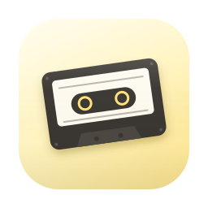
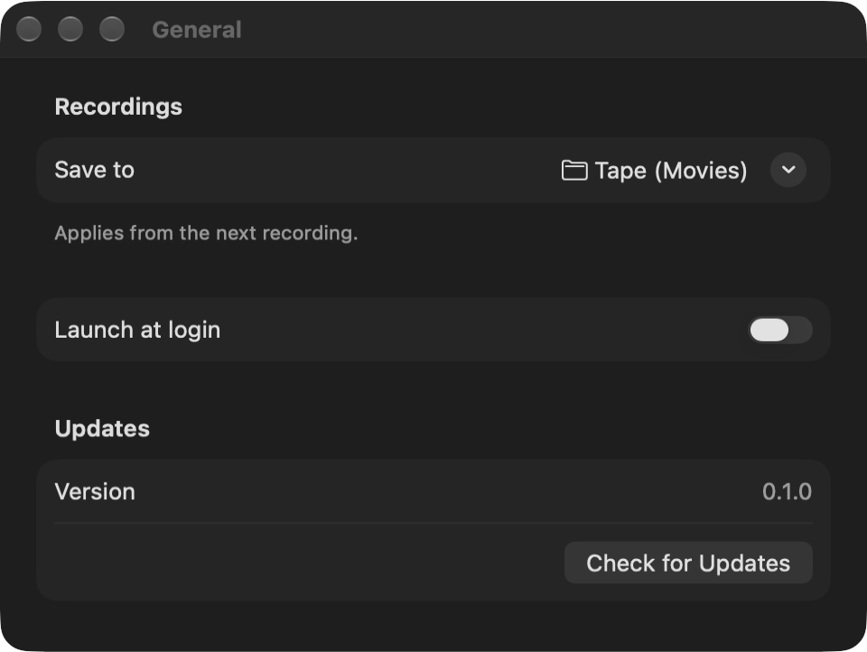
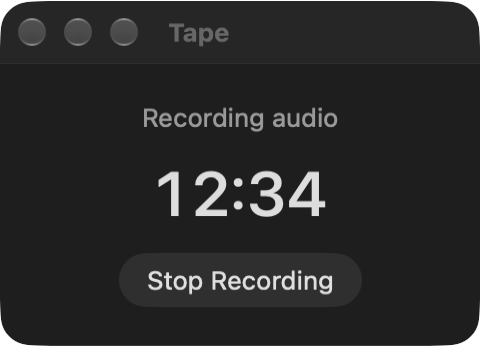

<div align="center">



# Tape

**Record your calls with one click.**

Records system audio and your microphone into one file, on this Mac only.

[Download](https://github.com/gustaferiksson/tape/releases/latest) · [Install with Homebrew](#install) · Requires macOS 26

</div>

<p align="center">
  
</p>

## What it does

Click the waveform in the menu bar, choose **Record Audio**, and Tape records everything your Mac plays plus your microphone into a single `.m4a` in `~/Movies/Tape`. Click **Stop Recording** and the file is ready to play, share or drop into a transcription tool, right from the menu's Recent list.

It works alongside Teams, Zoom, Meet or anything else that makes sound. Tape never changes your input or output device, so the call app doesn't notice it's there. There are no audio drivers or virtual devices to install: Tape uses a Core Audio process tap, which only needs macOS's **System Audio Recording Only** permission, not Screen Recording.

| | |
|---|---|
| **One file** | System audio and microphone mixed into one mono AAC `.m4a` (about 30 MB per hour), named like a screenshot: `Tape 2026-10-26 at 14.03.05.m4a`. |
| **Menu bar** | The label shows the elapsed time while recording, in plain monochrome so it never imitates the system's privacy indicators. Its menu, built like the system's Wi-Fi and Sound menus, has one Record/Stop row with a live timer, a Reduce Echo switch, and your recent recordings (click to open). |
| **Crash safe** | The file is written in fragments, so a crash or power loss loses at most about 10 seconds, and Tape recovers the file on next launch. |
| **Device changes** | Plug in headphones or switch microphones mid-call and Tape follows the system default input, keeping audio in sync. |
| **Quiet** | No notifications, no windows unless you ask. Quitting or logging out mid-recording saves the file first. |
| **Settings** | Save folder, launch at login and updates. |
| **Updates** | Checks GitHub Releases and installs new versions in place, never during a recording. |

If the menu bar icon is hidden, open Tape again from Finder or Spotlight: idle, it shows Settings, and while recording, a small window with the elapsed time and a Stop button.

<p align="center">
  
</p>

### Tell people you're recording

Recording a call without consent is illegal in many places, and rude everywhere else. Tape doesn't announce itself to the other side, so say it out loud. Also note that Tape records your microphone even while you're muted in the call app.

### Current state

Tape records audio only.

- **Echo reduction (experimental)**: on speakers, your microphone also hears the other side, so their voices appear twice with a slight delay. Turn on **Reduce Echo** in the menu or in Settings to run your microphone through macOS voice processing. It's off by default while it's being tested in real calls; headphones remain the cleanest option.

Planned next:

- **Screen recording**: pick a window, app or display with the system picker and get a `.mov` with the same mixed audio.

## Install

```sh
brew install --cask gustaferiksson/tap/tape
```

Or download `Tape-<version>.zip` from the [latest release](https://github.com/gustaferiksson/tape/releases/latest) and move `Tape.app` to `/Applications`. Tape is signed and notarized, and updates itself.

The first time you record, macOS asks for microphone access and then for system audio access. Both are needed: a call recording without the other side, or without you, is the wrong file. If you deny one, the menu shows a shortcut to the right pane in System Settings.

## Privacy

Tape is local only. Recordings stay in the folder you choose and are never uploaded. There's no account, analytics or telemetry. Its only network access is checking GitHub Releases for updates.

<details>
<summary><b>Building from source</b></summary>

<br>

You need Xcode, [XcodeGen](https://github.com/yonaskolb/XcodeGen) and `rsvg-convert` (`brew install xcodegen librsvg`).

```sh
./build.sh                                   # dist/Tape.app, ad hoc signed unless .env sets a team
open dist/Tape.app
swift test --package-path Packages/TapeCore  # run the tests
```

An ad hoc build gets a new code identity every time, so macOS asks for microphone and system audio access again after each build. Copy `.env.example` to `.env` and set your team and signing identity to build signed.

The Xcode project is generated by XcodeGen and isn't tracked. Releases are tagged and built by GitHub Actions, see [docs/RELEASING.md](docs/RELEASING.md) and [SHIPPING.md](SHIPPING.md). The UX spec is in [docs/flow.md](docs/flow.md).

</details>

## License

[MIT](LICENSE).
